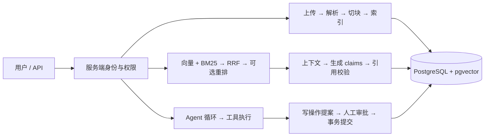

# KnowledgeOps Copilot

面向企业内部技术支持的知识问答与受控业务执行后端。用户可以检索有权限的文档、获得带来源引用的回答，并通过 Agent 查询模拟业务数据或提交需要人工审批的工单。

项目重点是 **证据、权限和执行状态如何贯穿完整流程**：从文档版本失效到引用校验，从模型提出工具调用到服务端授权、审批和事务提交。

Python · FastAPI · PostgreSQL · pgvector · BM25 · RRF · 单 Agent

> 本项目是可复现的本地工程演示。样例公司与文档均为虚构；默认 Fake 模型无需 API Key，用于检查流程，不能代表真实模型质量。当前身份头用于本地测试，尚未接入生产认证。

## 项目能做什么

| 能力 | 实现与边界 |
| --- | --- |
| 文档入库 | UTF-8 Markdown / TXT 上传、内容去重、异步解析、租约与失败重试 |
| 知识检索 | 结构/固定切块、来源坐标、pgvector 精确/HNSW 检索、BM25 + RRF、可选重排 |
| 引用问答 | 授权检索、上下文预算、结构化 claims、服务端组装回答、引用与当前版本校验 |
| 多轮会话 | 用户与租户隔离、原文摘要、revision 冲突检测、失效证据隐藏 |
| Agent | 四种工具、持久化检查点、执行预算、人工审批、幂等建单、显式恢复与 SSE 事件回放 |
| 工程验证 | 数据库集成测试、失败场景、来源 Recall/MRR、回答与业务终态分开评测 |

## 架构



详见 [架构与设计取舍](docs/design.md)。可交互的 [HTML 架构导航](docs/architecture/index.html) 包含 16 个节点、代码入口和中英术语；下载仓库后用浏览器打开，或运行 `python -m http.server 8765`，访问 `http://127.0.0.1:8765/docs/architecture/`。GitHub 文件预览不会直接运行 HTML。

## 快速开始：无需模型密钥

需要 Python 3.11+、Docker Compose 和已启动的 Docker。以下命令从项目根目录执行。首次使用建议 Python 3.12。

```sh
python -m venv .venv
# Windows PowerShell
.venv\Scripts\Activate.ps1
# macOS / Linux 使用：source .venv/bin/activate
python -m pip install -r requirements.lock
docker compose up -d --wait vectors
python scripts/demo.py init
python scripts/demo.py serve
```

Windows 如不便激活环境，可以把命令中的 `python` 换为 `.venv\Scripts\python.exe`。打开 [Swagger UI](http://127.0.0.1:8000/docs)，使用请求头 `X-Local-User-Id: u_engineer_001`。

`init` 在独立 `ko_demo` schema 中准备 **14 份虚构文档、100 个切块**、Fake 向量索引和 Agent 本地业务权限。所有持久化数据仍在同一 PostgreSQL 数据库。重复运行会复用上传与索引；该命令是样例初始化，会按样例清单配置 ACL，不要用于恢复真实用户权限。`serve` 固定使用 Fake 模型与 hybrid 检索，会忽略继承的真实模型配置。

依赖下载失败时可显式选择包源，见 [包源故障处理](docs/reproduce.md#包源访问失败)。

不想安装本机 Python 时，可使用 [容器运行方式](docs/reproduce.md#容器运行)。`.env.example` 是完整配置参考，不会自动加载到直接启动的 Uvicorn 进程。

## 演示与验证

```sh
# 独立临时 schema：通过实际 API 验证上传、问答、隔离、工具与审批，结束清理
python scripts/demo.py smoke
# 独立临时 schema：运行完整测试，包含 PostgreSQL / pgvector / 只读业务账号
python scripts/demo.py test
# ko_demo 的 20 题开发集：Fake 流程评测，结果不会代表真实模型效果
python scripts/demo.py evaluate
```

对外整理后的空数据库回归：**264 项通过**；核心演示 **14 项检查通过**。模型质量与运行控制流分别报告，不把测试通过率当成答案准确率。

手动演示请看 [五分钟 API 演示](docs/demo.md)，环境与故障排查请看 [复现指南](docs/reproduce.md)。评测说明和精选记录见 [验证证据与能力边界](docs/verification.md)。

## 代码导航

| 目录 | 职责 |
| --- | --- |
| `app/api/` | 请求契约、身份依赖、文档/问答/Agent 接口 |
| `app/ingestion/` | 文档解析、清洗、切块与入库工作者 |
| `app/retrieval/` | 向量检索、BM25、RRF、重排与再次授权 |
| `app/generation/` | 上下文预算、生成适配器、claims 与引用校验 |
| `app/agent/` | 工具协议、单 Agent 循环、预算、恢复 |
| `app/db/` | PostgreSQL 文档/会话/向量/Agent 仓储、事务与租约 |
| `sample_data/` / `eval_data/` | 虚构知识库、问题与来源标注、Agent 场景 |
| `tests/` | 单元、数据库与 HTTP 集成测试 |
| `docs/` | 当前架构、复现、演示、评测与中英术语导航 |

## 当前边界

- 只接收 Markdown / TXT；未实现 PDF/OCR、生产身份认证、跨组织真实业务集成。
- 文档更新会立即使旧切块头失效，随后显式重建与索引，期间可能暂时不可检索。
- Agent 采用自写循环；没有引入 LangGraph、多 Agent、MCP 或 Redis。模拟工单在本地 PostgreSQL 中提交。
- SSE 发送已校验答案的文本事件，未实现上游 Token 流式输出，也未验证真实 TTFT。
- 结构与引用校验不能保证语义正确。真实模型有历史验证与小样本评测，但完整 Agent 质量、云并发和生产稳定性尚未验证。

本地历史学习笔记、数据库文件、原始 prompts 和实验快照保留在工作区并默认排除上传。公开文档仅收录精选汇总；SQLite 只用于可选的一次性旧数据导入，不参与当前运行。
