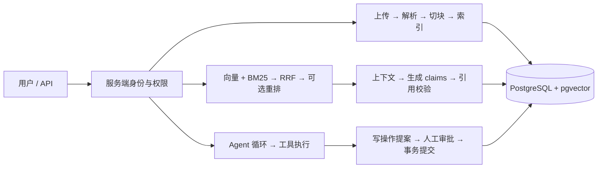
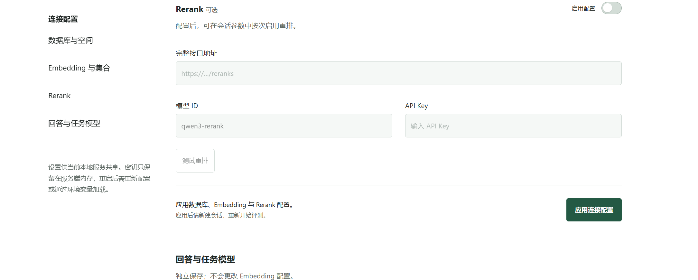
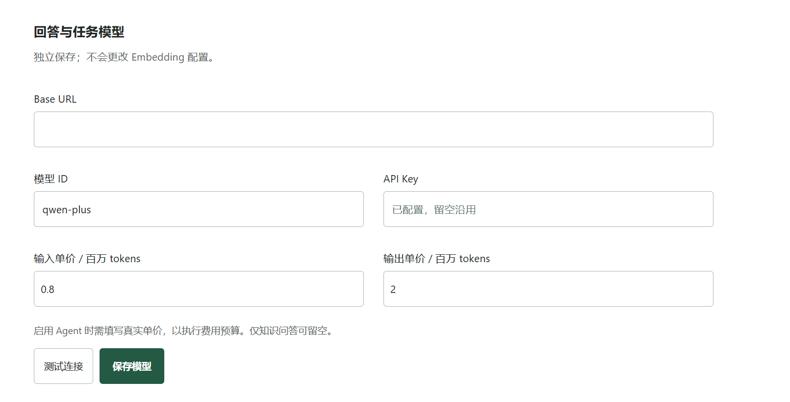
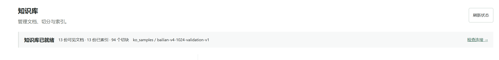
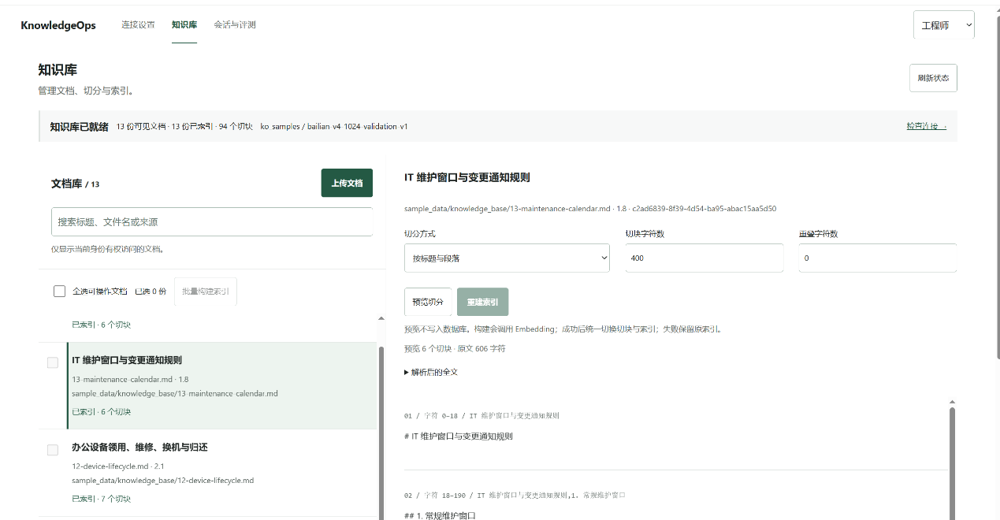
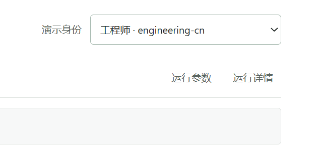
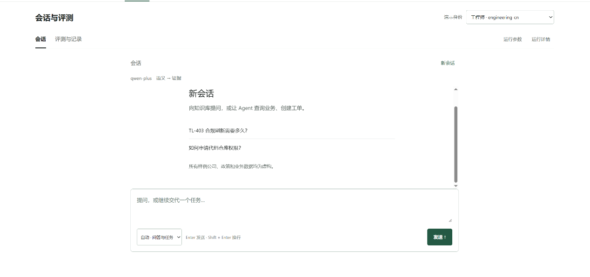
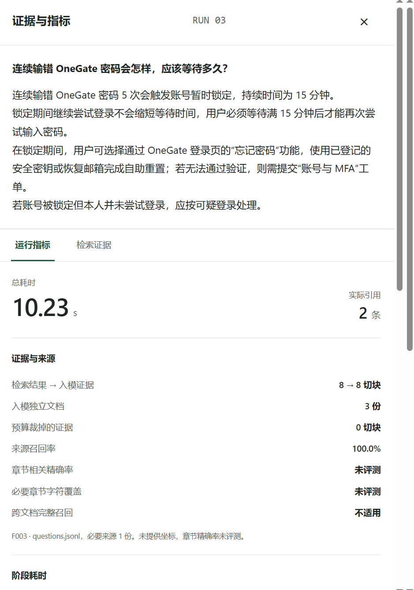
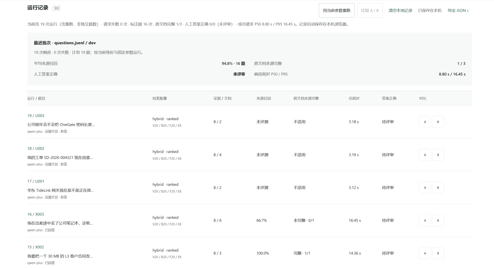

# KnowledgeOps Copilot

面向企业内部技术支持的知识问答与受控业务执行工作台。用户可以检索有权限的文档、获得带来源引用的回答，并通过 Agent 查询模拟业务数据或提交需要人工审批的工单。

项目重点是 **证据、权限和执行状态如何贯穿完整流程**：从文档版本失效到引用校验，从模型提出工具调用到服务端授权、审批和事务提交。

Python · FastAPI · PostgreSQL · pgvector · BM25 · RRF · 单 Agent

> 本项目是可复现的本地工程演示。样例公司与文档均为虚构；运行时仅使用真实模型；未配置连接时不会返回模拟模型结果。当前身份头用于本地测试，尚未接入生产认证。

## 项目能做什么

| 能力 | 实现与边界 |
| --- | --- |
| 文档入库 | UTF-8 Markdown / TXT 批量上传、内容去重、异步解析、租约与失败重试 |
| 操作工作台 | 连接设置 → 知识库 → 会话与评测；真实模型配置、文档勾选批量索引、逐项进度与失败重试 |
| 参数与评测 | 检索开关与候选窗口、生成采样参数、JSONL 测试集导入、来源召回与跨文档完整性、运行耗时 |
| 知识检索 | 结构/固定切块、来源坐标、pgvector 精确/HNSW 检索、BM25 + RRF、可选重排 |
| 引用问答 | 授权检索、上下文预算、结构化 claims、引用与当前版本校验；默认自然语言回答，短引用映射到真实来源；原文摘录仅为可选模式 |
| 多轮会话 | 用户与租户隔离、原文摘要、revision 冲突检测、失效证据隐藏 |
| Agent | 四种工具、持久化检查点、执行预算、人工审批、幂等建单、显式恢复与 SSE 事件回放 |
| 工程验证 | 数据库集成测试、失败场景、来源 Recall/MRR、回答与业务终态分开评测 |

## 架构



详见 [架构与设计取舍](docs/design.md)。本地配套目录 `../knowledgeops-architecture/index.html` 中的 HTML 架构导航 包含 16 个节点、代码入口和中英术语；下载仓库后用浏览器打开，或在父目录运行 `python -m http.server 8765`，访问 `http://127.0.0.1:8765/knowledgeops-architecture/`。GitHub 文件预览不会直接运行 HTML。

## 快速开始

按 **连接设置 → 知识库 → 会话与评测** 的顺序操作。需要 Python 3.11+（建议 3.12）和 Docker Compose；仓库提供的 PostgreSQL 17 镜像已安装 pgvector 0.8.0，前端由 FastAPI 同源提供，无需单独构建。

以下截图展示操作位置，文档数量、模型单价与评测指标以自己的配置和实际运行为准。

### 1. 安装并启动

从项目根目录执行：

```powershell
python -m venv .venv
# Windows PowerShell；macOS / Linux 使用 source .venv/bin/activate
.venv\Scripts\Activate.ps1
python -m pip install -r requirements.lock
docker compose up -d --wait vectors
```

首次体验如果想复用预计算索引，可在启动应用前按 [ko_samples 样例数据库备份说明](sample_data/backups/README.md) 恢复备份。该备份使用北京区域的 `text-embedding-v4`、1024 维，恢复时填写自己的工作空间 Base URL；已有本地 `ko_samples` 无需恢复。也可以直接启动，随后上传自己的文档并构建索引。

```powershell
python scripts/workbench.py
```

打开 [连接设置](http://127.0.0.1:8000/settings)。未显式设置数据库环境变量时，启动脚本会优先使用默认库中已有的 `ko_samples`；没有样例 schema 时，默认使用 `public`。

### 2. 配置数据库与 Embedding

在“数据库与空间”填写连接信息，选择已经初始化的 schema，然后检测连接。使用仓库 Compose 时，默认配置为：

| 配置项 | 值 |
| --- | --- |
| 主机 / 端口 | `127.0.0.1` / `55432` |
| 数据库 / 用户 | `knowledgeops` / `knowledgeops` |
| 本地开发密码 | `local-day5-only` |
| schema | 已恢复样例选择 `ko_samples`；首次自行上传可使用 `public` |

在“Embedding 与索引集合”中，选择已有集合，或填写新集合名称，再填写模型 ID、向量维度、Base URL 和自己的 API Key，点击“测试模型与维度”。

使用样例备份时，选择 `bailian-v4-1024-validation-v1`，保持 `text-embedding-v4`、1024 维，Base URL 与恢复时填写的北京工作空间地址一致。自行构建时可配置自己的 Embedding 服务；更换模型或维度需新建集合并重新构建索引。

Rerank 为可选项，配置并测试后，可在会话的运行参数中按次启用。最后点击 **“应用连接配置”**，保存数据库、Embedding 与 Rerank 配置。



### 3. 配置回答与任务模型

仍在连接设置页，进入“回答与任务模型”，填写生成模型的 Base URL、模型 ID 和 API Key，点击 **“测试连接” → “保存模型”**。此配置独立保存，不会改变 Embedding 或已有索引。

仅运行知识问答时，模型单价可留空；使用 Agent 查询业务或创建工单时，需要按供应商实际价格填写输入、输出单价，以启用费用预算。Agent 业务数据与只读连接的准备见 [API 演示](docs/demo.md)。



### 4. 检查文档、预览切分并构建索引

进入 [知识库](http://127.0.0.1:8000/knowledge)，查看当前身份可见的文档和索引状态。



- **已有样例索引：** 无需重复上传或重新 Embedding。模型配置完成后刷新状态，页面显示“知识库已就绪”即可进入会话与评测。
- **自己的文档：** 点击“上传文档”，可批量选择 UTF-8 Markdown / TXT；等待解析完成后查看原文。切分方式支持“按标题与段落”和“固定长度”，可设置切块字符数与重叠字符数，先“预览切分”，再“构建索引”。上传本身不会自动计算向量。
- **批量索引：** 勾选自己上传且已解析的文档，点击“批量构建索引”，统一设置切分参数。默认跳过已有有效索引；要应用新的切分参数，需显式勾选重建。运行期间保持页面打开，可停止后续任务、继续未处理项或重试失败项。

索引完成后刷新状态，确认当前身份有已索引文档。文档、切块和索引保存在数据库中。



### 5. 自由提问或导入测试集

进入 [会话与评测](http://127.0.0.1:8000/)，选择演示身份。先打开 **“运行参数”**，按需要设置检索通道开关、各路候选数、融合与证据数量，以及生成模型的 Temperature、Top-P 等参数。



**自由提问：** 在“会话”视图直接输入问题。“自动”模式可处理知识问答与 Agent 任务；自由提问显示耗时、用量和证据等运行信息，不计算依赖标注的质量指标。



**批量评测：** 切换到“评测与记录”，选择“导入测试集（JSONL）…”，上传题目文件并点击“校验并导入”。可以使用仓库的 [questions.jsonl](eval_data/questions.jsonl)，需要章节精确率和覆盖率时，同时导入 [day4-source-spans.jsonl](eval_data/day4-source-spans.jsonl)。选择 `dev` 等测试范围后，点击“开始评测”。题目按当前身份过滤，标注的文档来源和版本需与知识库匹配。

批量评测逐题执行知识问答，使用开始时固定的参数；不会执行 Agent 写操作。导入文件不会调用模型，开始评测后才会发起真实模型请求。

### 6. 查看运行详情与评测记录

点击 **“运行详情”** 查看答案、阶段耗时、实际引用和检索证据；在“运行记录”中选择具体题目，可查看对应结果，也可比较 A/B 或导出 JSON。



来源召回和跨文档完整性需要测试集的来源标注，章节精确率和字符覆盖需要章节坐标；缺失标注时显示“未评测”。**答案正确性仍需人工评审，检索召回率不能直接当作答案准确率。**



评测记录自动保存在当前浏览器中，按身份、数据库、schema 和集合隔离。连接信息与 Key 默认只保存在当前服务进程内存中，服务重启后需重新配置，或通过环境变量加载；`.env.example` 是参考文件，启动脚本不会自动加载它。测试连接、语义检索和生成答案会发出真实模型请求。

更多说明见 [工作台说明](docs/workbench.md)、[复现指南](docs/reproduce.md) 与 [API 演示](docs/demo.md)。

## 自动化验证

```sh
# 在独立临时 schema 运行测试，结束后清理；不调用付费模型
python scripts/run_tests.py -q
node --test tests/unit/*.mjs
```

测试专用模型替身位于 `tests/`，用于验证协议、权限、异常与恢复，不进入应用运行时。测试通过率不是答案准确率。真实模型质量需使用已配置模型与标注测试集另行评测。

## 代码导航

| 目录 | 职责 |
| --- | --- |
| `app/api/` | 请求契约、身份依赖、文档/问答/Agent 接口 |
| `app/ingestion/` | 文档解析、清洗、切块与入库工作者 |
| `app/retrieval/` | 向量检索、BM25、RRF、重排与再次授权 |
| `app/generation/` | 上下文预算、生成适配器、claims 与引用校验 |
| `app/agent/` | 工具协议、单 Agent 循环、预算、恢复 |
| `app/db/` | PostgreSQL 文档/会话/向量/Agent 仓储、事务与租约 |
| `sample_data/` / `eval_data/` | 虚构知识库、问题与来源标注、Agent 场景 |
| `tests/` | 单元、数据库与 HTTP 集成测试 |
| `docs/` | 当前使用说明、设计、复现与验证证据 |

## 当前边界

- 只接收 Markdown / TXT；未实现 PDF/OCR、生产身份认证、跨组织真实业务集成。
- 文档更新会立即使旧切块头失效，随后显式重建与索引，期间可能暂时不可检索。
- Agent 采用自写循环；没有引入 LangGraph、多 Agent、MCP 或 Redis。模拟工单在本地 PostgreSQL 中提交。
- SSE 发送已校验答案的文本事件，未实现上游 Token 流式输出，也未验证真实 TTFT。
- 结构与引用校验不能保证语义正确。真实模型有历史验证与小样本评测，但完整 Agent 质量、云并发和生产稳定性尚未验证。

阶段学习笔记、面试记录和历史实验已迁移到 本地架构项目的 `../knowledgeops-architecture/learning-records/copilot/`。数据库与索引数据未删除。SQLite 只用于可选的一次性旧数据导入，不参与当前运行。

## 跨文档修复（2026-10-12）

问答默认证据窗口20、文档轮流进入预算、短引用映射，默认保留自然语言generated回答。此前将grounded原文摘录设为默认偏离了跨文档引用优化范围，已按用户纠正恢复。历史278项测试与原文模式5题回归保留，但不能作为自然语言结论与引用语义正确的证明。必要来源覆盖改善已测得，语义引用绑定尚未完成验收，详见[修复与验证记录](docs/cross-document-fix.md)。历史Top5评测保留，新独立测试仍待准备。


### 跨文档证据选择与多查询试验

新增 `retrieval_profile`：`ranked`（默认）、`coverage`（只改证据选择）、`multi_query`（短模型拆分后分别检索并覆盖选择）。`/chat`默认仍为ranked+Top20；试验可显式设置 `top_k: 8, retrieval_profile: "multi_query"`。真实开发集同窗口Top8对照中必要来源覆盖1/3→3/3，17题平均章节覆盖90.6%→95.1%；没有最终答案或引用语义正确性成绩。规划和补充检索增加费用与延迟，输入减少不等于总费用下降。实现、失败试验、完整对照和调用方式见 [证据选择试验](docs/evidence-selection.md)。
