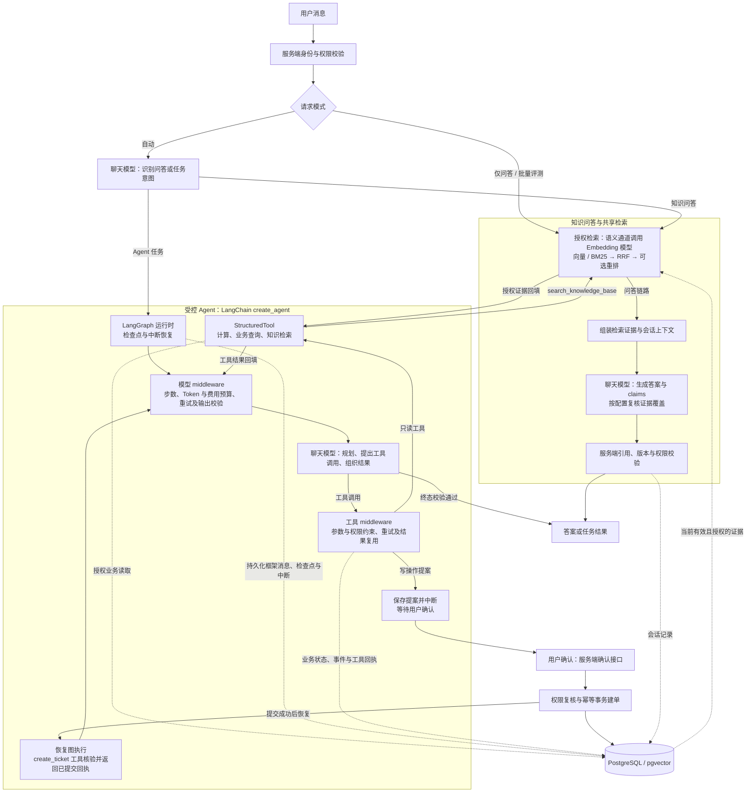
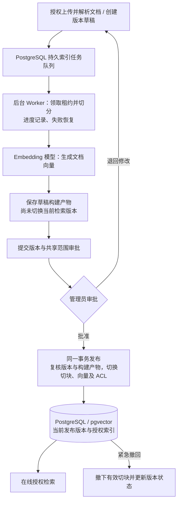

# KnowledgeOps Copilot

面向企业内部技术支持的知识问答与受控业务执行工作台。用户可以检索有权限的文档、获得带来源引用的回答，并通过 Agent 查询模拟业务数据或提交需要人工审批的工单。

项目重点是 **证据、权限和执行状态如何贯穿完整流程**：从文档版本失效到引用校验，从模型提出工具调用到服务端授权、审批和事务提交。

Python · FastAPI · LangChain · PostgreSQL · pgvector · BM25 · RRF · 单 Agent

> 本项目是可复现的本地工程演示。样例公司、企业政策与业务记录均为虚构；中文技术指南来自 GNOME 官方帮助并保留来源与许可；运行时仅使用真实模型；未配置连接时不会返回模拟模型结果。默认身份头用于本地演示；可启用自有账号模式，账号模式会忽略该请求头。尚未接入企业 SSO/MFA。

## 项目能做什么

| 能力 | 实现与边界 |
| --- | --- |
| 文档入库 | UTF-8 Markdown / TXT 批量上传、内容去重、异步解析、租约与失败重试 |
| 操作工作台 | 连接设置 → 知识库 → 会话与评测；真实模型配置、文档勾选批量索引、逐项进度与失败重试 |
| 账号与后台业务 | 自有账号登录、管理员隔离、持久后台索引任务、工单领取到关闭与站内通知；[启用与操作](docs/accounts-and-operations.md) |
| 知识生命周期 | 草稿、管理员审批发布、历史原文/差异、以旧版创建新版、紧急撤回、ACL 说明与审计；[操作演示](docs/document-lifecycle.md) |
| 参数与评测 | 检索开关与候选窗口、生成采样参数、JSONL 测试集导入、来源召回与跨文档完整性、运行耗时 |
| 知识检索 | 结构/固定切块、来源坐标、pgvector 精确/HNSW 检索、BM25 + RRF、可选重排 |
| 流式回答 | SSE 传递处理进度，回答完整校验并保存后逐字展示；生成期间断开连接会取消上游工作 |
| 引用问答 | 授权检索、上下文预算、结构化 claims、适用条件与引用校验；自然语言回答，短引用映射到真实来源 |
| 多轮会话 | 用户与租户隔离、原文摘要、revision 冲突检测、失效证据隐藏 |
| Agent | 四种工具、持久化检查点、执行预算、可编辑工单提案、人工审批、幂等建单与执行回执 |
| 业务与工单 | 查看本人设备、账号安全、工单状态和独立耗时示例；工单列表、详情、审批与处理记录 |
| 工程验证 | 数据库集成测试、失败场景、来源 Recall/MRR、回答与业务终态分开评测 |

近期变更见 [2026-10-16 更新日志](CHANGELOG.md#2026-10-16)。资料准备与许可见 [中文企业知识库](datasets/enterprise-zh/README.md)，问答与 Agent 验收资料见 [测试集](eval_data/enterprise-zh-20261016/README.md)。

## 架构



**两条链路都会调用真实聊天模型：** 知识问答默认先检索证据，再交给模型生成答案；Agent 由 `create_agent` 驱动模型与工具循环，并复用同一套授权检索能力。“自动”模式还会先调用模型识别意图；“仅问答”和批量评测直接进入问答链路。多查询检索配置另有模型规划步骤。证据为空或预算不足时，服务端可以提前拒答，不必发起答案生成请求。

Agent 的 middleware 负责模型与工具调用限制，服务层另设运行时限和并发控制。工单提案通过 LangGraph 中断等待用户确认；服务端确认接口复核权限并在事务中建单，再恢复 Agent，`create_ticket` 工具只核验并返回已提交的回执。用户拒绝提案时任务取消。这一步确认提交与工单后续业务审批分别处理。

文档构建与发布独立于在线问答。上传时由程序解析原文，后台 Worker 切分并调用 Embedding 模型；草稿构建完成后，须经管理员批准才切换当前检索版本：



任务队列、草稿构建产物与审批记录均保存在 PostgreSQL。Worker 可随服务启动，也可独立运行。已有有效发布版本在新草稿构建和待审批期间继续提供检索；紧急撤回后，该文档不再参与检索。

当前流程、事务与检索策略见 [架构与设计取舍](docs/design.md)，全部使用与维护资料见 [文档目录](docs/README.md)。

第三阶段 `create_agent` 迁移已通过用户业务验收；长会话记忆、上下文压缩与 LangSmith 接入尚未实施。后续安排见[分阶段迁移计划](docs/langchain-migration.md)，操作边界见 [Agent 图与验收](docs/agent-langgraph.md)。

## 快速开始

按 **连接设置 → 知识库 → 会话与评测** 的顺序操作。需要 Python 3.11+（建议 3.12）和已运行的 Docker Compose 环境（Windows 先启动 Docker Desktop，并使用 Linux 容器）；仓库提供的 PostgreSQL 17 镜像已安装 pgvector 0.8.0，前端由 FastAPI 同源提供，无需单独构建。

以下截图展示操作位置，文档数量、模型单价与评测指标以自己的配置和实际运行为准。

### 1. 安装并启动

先克隆仓库并进入项目目录：

```sh
git clone https://github.com/thxuan/knowledgeops-copilot.git
cd knowledgeops-copilot
```

从项目根目录安装依赖并启动数据库：

```powershell
python -m venv .venv
# Windows PowerShell；macOS / Linux 使用 source .venv/bin/activate
.venv\Scripts\Activate.ps1
python -m pip install -r requirements.lock
docker compose up -d --wait vectors
```

首次体验如果想复用预计算索引，可在启动应用前按 [ko_samples 样例数据库备份说明](sample_data/backups/README.md) 恢复备份。该备份使用北京区域的 `text-embedding-v4`、1024 维，恢复时填写自己的工作空间 Base URL；已有本地 `ko_samples` 无需恢复。也可以直接启动，随后上传自己的文档并构建索引。

```powershell
python scripts/workbench.py
```

打开 [连接设置](http://127.0.0.1:8000/settings)。未显式设置数据库环境变量时，启动脚本会优先使用默认库中已有的 `ko_samples`；没有样例 schema 时，默认使用 `public`。

### 2. 配置数据库与 Embedding

在“数据库与空间”填写连接信息，选择已经初始化的 schema，然后检测连接。使用仓库 Compose 时，默认配置为：

| 配置项 | 值 |
| --- | --- |
| 主机 / 端口 | `127.0.0.1` / `55432` |
| 数据库 / 用户 | `knowledgeops` / `knowledgeops` |
| 本地开发密码 | `local-day5-only` |
| schema | 已恢复样例选择 `ko_samples`；首次自行上传可使用 `public` |

在“Embedding 与索引集合”中，选择已有集合，或填写新集合名称，再填写模型 ID、向量维度、Base URL 和自己的 API Key，点击“测试模型与维度”。

使用样例备份时，选择 `bailian-v4-1024-validation-v1`，保持 `text-embedding-v4`、1024 维，Base URL 与恢复时填写的北京工作空间地址一致。自行构建时可配置自己的 Embedding 服务；更换模型或维度需新建集合并重新构建索引。

Rerank 为可选项，配置并测试后，可在会话的运行参数中按次启用。最后点击 **“应用连接配置”**，保存数据库、Embedding 与 Rerank 配置。


### 3. 配置回答与任务模型

仍在连接设置页，进入“回答与任务模型”，填写生成模型的 Base URL、模型 ID 和 API Key，点击 **“测试连接” → “保存模型”**。此配置独立保存，不会改变 Embedding 或已有索引。

**知识问答和 Agent 都会调用真实聊天模型，是否填写单价不决定供应商是否收费。** 建议按供应商实际价格填写输入、输出单价；这两项当前用于 Agent 的本地费用估算与执行预算校验。首次只启用知识问答时，代码允许不填单价，但仍会发起模型请求；启用 Agent 时两项必须填写。已启用 Agent 后更换模型，也必须提供对应单价。Agent 业务数据与只读连接的准备见 [API 演示](docs/demo.md)。


### 4. 检查文档、预览切分并构建索引

进入 [知识库](http://127.0.0.1:8000/knowledge)，查看当前身份可见的文档和索引状态。


- **已有样例索引：** 无需重复上传或重新 Embedding。模型配置完成后刷新状态，页面显示“知识库已就绪”即可进入会话与评测。
- **自己的文档：** 点击“上传文档”，可批量选择 UTF-8 Markdown / TXT；等待解析完成后查看原文。切分方式支持“按标题与段落”和“固定长度”，可设置切块字符数与重叠字符数，先“预览切分”，再“构建索引”。上传本身不会自动计算向量。
- **批量索引：** 勾选自己上传且已解析的文档，点击“批量构建索引”，统一设置切分参数。默认跳过已有有效索引；要应用新的切分参数，需显式勾选重建。运行期间保持页面打开，可停止后续任务、继续未处理项或重试失败项。

索引完成后刷新状态，确认当前身份有已索引文档。文档、切块和索引保存在数据库中。


### 5. 自由提问或导入测试集

进入 [会话与评测](http://127.0.0.1:8000/)，选择演示身份。先打开 **“运行参数”**，按需要设置检索通道开关、各路候选数、融合与证据数量，以及生成模型的 Temperature、Top-P 等参数。


**自由提问：** 在“会话”视图直接输入问题。“自动”模式可处理知识问答与 Agent 任务；自由提问显示耗时、用量和证据等运行信息，不计算依赖标注的质量指标。


**批量评测：** 切换到“评测与记录”，选择“导入测试集（JSONL）…”，上传题目文件并点击“校验并导入”。可以使用仓库的 [questions.jsonl](eval_data/questions.jsonl)，需要章节精确率和覆盖率时，同时导入 [day4-source-spans.jsonl](eval_data/day4-source-spans.jsonl)。选择 `dev` 等测试范围后，点击“开始评测”。题目按当前身份过滤，标注的文档来源和版本需与知识库匹配。

批量评测逐题执行知识问答，使用开始时固定的参数；不会执行 Agent 写操作。导入文件不会调用模型，开始评测后才会发起真实模型请求。

### 6. 查看运行详情与评测记录

点击 **“运行详情”** 查看答案、阶段耗时、实际引用和检索证据；在“运行记录”中选择具体题目，可查看对应结果，也可比较 A/B 或导出 JSON。


来源召回和跨文档完整性需要测试集的来源标注，章节精确率和字符覆盖需要章节坐标；缺失标注时显示“未评测”。**答案正确性仍需人工评审，检索召回率不能直接当作答案准确率。**


评测记录自动保存在当前浏览器中，按身份、数据库、schema 和集合隔离。连接信息与 Key 默认只保存在当前服务进程内存中，服务重启后需重新配置，或通过环境变量加载；`.env.example` 是参考文件，启动脚本不会自动加载它。测试连接、语义检索和生成答案会发出真实模型请求。

更多说明见 [工作台说明](docs/workbench.md)、[复现指南](docs/reproduce.md) 与 [API 演示](docs/demo.md)。

## 自动化验证

```sh
# 在独立临时 schema 运行测试，结束后清理；不调用付费模型
python scripts/run_tests.py -q
node --test tests/unit/*.mjs
```

测试专用模型替身位于 `tests/`，用于验证协议、权限、异常与恢复，不进入应用运行时。测试通过率不是答案准确率。真实模型质量需使用已配置模型与标注测试集另行评测。

## 代码导航

| 目录 | 职责 |
| --- | --- |
| `app/api/` | 请求契约、身份依赖、文档/问答/Agent 接口 |
| `app/ingestion/` | 文档解析、清洗、切块与入库工作者 |
| `app/retrieval/` | 向量检索、BM25、RRF、重排与再次授权 |
| `app/generation/` | 上下文预算、生成适配器、claims 与引用校验 |
| `app/agent/` | 工具协议、单 Agent 循环、预算、恢复 |
| `app/db/` | PostgreSQL 文档/会话/向量/Agent 仓储、事务与租约 |
| `sample_data/` / `eval_data/` | 虚构知识库、问题与来源标注、Agent 场景 |
| `tests/` | 单元、数据库与 HTTP 集成测试 |
| `docs/` | 当前使用说明、设计、复现与验证证据 |

## 当前边界

- 只接收 Markdown / TXT；未实现 PDF/OCR、企业 SSO/MFA、跨组织真实业务集成。
- 页面采用草稿构建后显式发布，准备期间保留有效旧版；历史由上传者和平台管理员审阅，版本发布须经管理员审批。旧 PUT 正文更新接口已停用，防止绕过审批。构建提交持久后台队列；可使用服务内 worker 或独立 worker 命令。
- 单 Agent 使用 LangChain create_agent 和业务 middleware，LangGraph/PostgreSQL 持久化框架消息、检查点与中断。模拟工单仍由服务端确认接口在事务中提交。第三阶段完成关键离线检查并通过用户业务验收；长会话记忆与 LangSmith 接入尚未实施。
- 自由知识问答完整校验并保存后逐字展示正文；Agent 事件提供任务回放。尚未验证真实负载下的 TTFT。
- 结构与引用校验不能保证语义正确。真实模型有历史验证与小样本评测，但完整 Agent 质量、云并发和生产稳定性尚未验证。

历史需求、阶段笔记、面试记录与试验过程已归档到本地配套项目 `knowledgeops-architecture/learning-records/copilot/`；主仓库文档描述当前功能与验证范围。

文档上传、共享与审批操作见 [文档审阅与发布审批](docs/document-review.md)。
