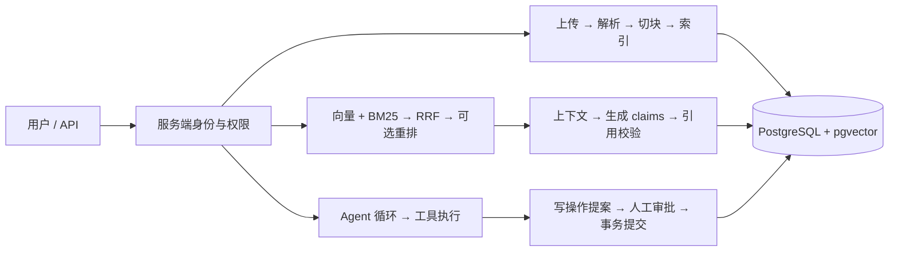

# KnowledgeOps Copilot

面向企业内部技术支持的知识问答与受控业务执行工作台。用户可以检索有权限的文档、获得带来源引用的回答，并通过 Agent 查询模拟业务数据或提交需要人工审批的工单。

项目重点是 **证据、权限和执行状态如何贯穿完整流程**：从文档版本失效到引用校验，从模型提出工具调用到服务端授权、审批和事务提交。

Python · FastAPI · PostgreSQL · pgvector · BM25 · RRF · 单 Agent

> 本项目是可复现的本地工程演示。样例公司与文档均为虚构；运行时仅使用真实模型；未配置连接时不会返回模拟模型结果。当前身份头用于本地测试，尚未接入生产认证。

## 项目能做什么

| 能力 | 实现与边界 |
| --- | --- |
| 文档入库 | UTF-8 Markdown / TXT 批量上传、内容去重、异步解析、租约与失败重试 |
| 操作工作台 | 连接设置 → 知识库 → 会话与评测；真实模型配置、文档勾选批量索引、逐项进度与失败重试 |
| 参数与评测 | 检索开关与候选窗口、生成采样参数、JSONL 测试集导入、来源召回与跨文档完整性、运行耗时 |
| 知识检索 | 结构/固定切块、来源坐标、pgvector 精确/HNSW 检索、BM25 + RRF、可选重排 |
| 引用问答 | 授权检索、上下文预算、结构化 claims、引用与当前版本校验；默认自然语言回答，短引用映射到真实来源；原文摘录仅为可选模式 |
| 多轮会话 | 用户与租户隔离、原文摘要、revision 冲突检测、失效证据隐藏 |
| Agent | 四种工具、持久化检查点、执行预算、人工审批、幂等建单、显式恢复与 SSE 事件回放 |
| 工程验证 | 数据库集成测试、失败场景、来源 Recall/MRR、回答与业务终态分开评测 |

## 架构



详见 [架构与设计取舍](docs/design.md)。本地配套目录 `../knowledgeops-architecture/index.html` 中的 HTML 架构导航 包含 16 个节点、代码入口和中英术语；下载仓库后用浏览器打开，或在父目录运行 `python -m http.server 8765`，访问 `http://127.0.0.1:8765/knowledgeops-architecture/`。GitHub 文件预览不会直接运行 HTML。

## 快速开始

需要 Python 3.11+（建议 3.12）与带 pgvector 的 PostgreSQL。从项目根目录执行：

```sh
python -m venv .venv
# Windows PowerShell；macOS / Linux 使用 source .venv/bin/activate
.venv\Scripts\Activate.ps1
python -m pip install -r requirements.lock
docker compose up -d --wait vectors
python scripts/workbench.py
```

打开 [连接设置](http://127.0.0.1:8000/settings)，配置数据库、真实聊天模型、Embedding 与可选 Reranker；进入“知识库”批量上传 Markdown/TXT，勾选已解析文档、设置切分参数并批量构建索引，最后进入“会话与评测”。连接配置也可通过环境变量提供，`.env.example` 是参考文件，直接启动时不会自动加载。

页面由 FastAPI 同源提供，无需单独构建前端。聊天模型的 Key / Base URL 可在页面配置；服务重启后需重新填写仅保存在内存中的连接信息。自由提问只显示运行指标；导入带来源标注的 JSONL 测试集后可运行来源召回和跨文档完整性评测。答案正确性需单独评审。

批量任务按文档顺序执行，默认跳过当前集合的有效索引；重建需显式勾选。支持停止后续任务和失败项重试，执行期间需保持页面打开，已完成的文档与索引保存在数据库。

详见 [工作台说明](docs/workbench.md)、[复现指南](docs/reproduce.md) 与 [API 演示](docs/demo.md)。

## 自动化验证

```sh
# 在独立临时 schema 运行测试，结束后清理；不调用付费模型
python scripts/run_tests.py -q
node --test tests/unit/*.mjs
```

测试专用模型替身位于 `tests/`，用于验证协议、权限、异常与恢复，不进入应用运行时。测试通过率不是答案准确率。真实模型质量需使用已配置模型与标注测试集另行评测。

## 代码导航

| 目录 | 职责 |
| --- | --- |
| `app/api/` | 请求契约、身份依赖、文档/问答/Agent 接口 |
| `app/ingestion/` | 文档解析、清洗、切块与入库工作者 |
| `app/retrieval/` | 向量检索、BM25、RRF、重排与再次授权 |
| `app/generation/` | 上下文预算、生成适配器、claims 与引用校验 |
| `app/agent/` | 工具协议、单 Agent 循环、预算、恢复 |
| `app/db/` | PostgreSQL 文档/会话/向量/Agent 仓储、事务与租约 |
| `sample_data/` / `eval_data/` | 虚构知识库、问题与来源标注、Agent 场景 |
| `tests/` | 单元、数据库与 HTTP 集成测试 |
| `docs/` | 当前使用说明、设计、复现与验证证据 |

## 当前边界

- 只接收 Markdown / TXT；未实现 PDF/OCR、生产身份认证、跨组织真实业务集成。
- 文档更新会立即使旧切块头失效，随后显式重建与索引，期间可能暂时不可检索。
- Agent 采用自写循环；没有引入 LangGraph、多 Agent、MCP 或 Redis。模拟工单在本地 PostgreSQL 中提交。
- SSE 发送已校验答案的文本事件，未实现上游 Token 流式输出，也未验证真实 TTFT。
- 结构与引用校验不能保证语义正确。真实模型有历史验证与小样本评测，但完整 Agent 质量、云并发和生产稳定性尚未验证。

阶段学习笔记、面试记录和历史实验已迁移到 本地架构项目的 `../knowledgeops-architecture/learning-records/copilot/`。数据库与索引数据未删除。SQLite 只用于可选的一次性旧数据导入，不参与当前运行。

## 跨文档修复（2026-10-12）

问答默认证据窗口20、文档轮流进入预算、短引用映射，默认保留自然语言generated回答。此前将grounded原文摘录设为默认偏离了跨文档引用优化范围，已按用户纠正恢复。历史278项测试与原文模式5题回归保留，但不能作为自然语言结论与引用语义正确的证明。必要来源覆盖改善已测得，语义引用绑定尚未完成验收，详见[修复与验证记录](docs/cross-document-fix.md)。历史Top5评测保留，新独立测试仍待准备。


### 跨文档证据选择与多查询试验

新增 `retrieval_profile`：`ranked`（默认）、`coverage`（只改证据选择）、`multi_query`（短模型拆分后分别检索并覆盖选择）。`/chat`默认仍为ranked+Top20；试验可显式设置 `top_k: 8, retrieval_profile: "multi_query"`。真实开发集同窗口Top8对照中必要来源覆盖1/3→3/3，17题平均章节覆盖90.6%→95.1%；没有最终答案或引用语义正确性成绩。规划和补充检索增加费用与延迟，输入减少不等于总费用下降。实现、失败试验、完整对照和调用方式见 [证据选择试验](docs/evidence-selection.md)。
